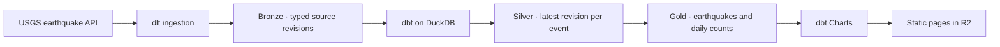

# Data

Lagom processes public data in batches. The operator leads decisions about
sources, models, contracts and reports. Agents implement those decisions and
bring options with trade-offs. For the node, deployment, credentials and
limits, see [Platform](platform.md).

## Ingestion — dlt

dlt is a Python library that runs inside a job. Its REST source reads a
declarative configuration for endpoints, pagination and the cursor. The
cursor is the checkpoint for incremental extraction. It persists with the
destination so the next run can pick up where the previous load ended.

The United States Geological Survey (USGS) is the first source. Bronze keeps
distinct revisions by source event ID and update timestamp. The
[source documentation](../data/sources/usgs/README.md) describes the write
disposition, API window, backfills, input checks and replay limits.

## Storage — DuckLake on R2

DuckDB is the query engine. DuckLake is the table format. Its catalog in
Postgres tracks the schema, snapshots and files that make up each version of a
table. The files live in R2 (Cloudflare's object storage) as Parquet, a
column-oriented file format. Committing a catalog transaction makes a set of
file changes visible together. Compute runs inside jobs and then releases its
memory. The catalog stays resident and is part of
[Postgres recovery](platform.md#backups).

Staging and production both run USGS on DuckLake with their own catalogs
and buckets. Postgres remains a supported local development target for
dlt and dbt using the staging developer database. The two targets differ in
adapter, grants and connection settings. See the
[warehouse targets](../data/warehouse/README.md#two-targets-postgres-and-ducklake)
and the decision to compare this stack with Postgres
([ADR-0023](adr/0023-sme-stack-duckdb-on-ducklake.md),
[ADR-0026](adr/0026-dagster-one-instance-per-environment.md)).

## Transformation — dbt

dbt runs SQL models in dependency order and checks their output. Dagster
runs `dbt build` on the `lake` target after ingestion. Bronze is the
typed source record, silver selects and standardizes the current revision,
and gold publishes the interface consumers read. Gold has enforced
contracts, which specify column names and types. USGS publishes
`fct_earthquakes` and `agg_earthquakes_daily_region`. See the
[warehouse decisions and tests](../data/warehouse/README.md#what-the-models-decide).

Reconciliation checks expected relationships between layers. For example,
the number of silver rows equals the number of distinct bronze event IDs,
and the sum of daily earthquake counts equals the number of gold facts.
CI builds the lake from a fixed bronze fixture. The checks in real runs
also reconcile data read from the environment's lake. Freshness checks
compare bronze with the clock via a separate `dbt source freshness` command.
See [warehouse tests](../data/warehouse/README.md#tests) for thresholds and
exact coverage, and the [engineering protocol](engineering-protocol.md#16-data-platform-engineering)
for requirements that apply to every source.

## Orchestration — Dagster jobs

An asset describes a dataset the platform produces. Dagster uses asset
dependencies to order the work and record lineage (which input produced which
output). It launches work in Kubernetes jobs, while Dagster's own state is
kept in Postgres. The [deployment](platform.md#dagsters-deployment) explains
the run slot and environment isolation. The
[code location](../data/orchestration/README.md) bundles the pipelines and
warehouse project into one image.

| Job | Trigger (UTC) | Work |
|---|---|---|
| `usgs` | Every 30 minutes | Ingest USGS revisions, then build and test silver and gold |
| `lake_maintenance` | Daily at 04:15 | Compact small files, expire snapshots older than seven days, delete unreferenced files and refresh the catalog reader's grants |
| `dashboards` | After a successful `usgs` run | Render, reconcile and publish reports, then dbt's documentation |

The [pipeline heartbeat](runbook.md#pipeline-heartbeat) verifies that runs keep
succeeding. A failure sends its run identifier and redacted error to the same
Healthchecks.io check. The writer jobs still use the catalog owner's
connection string and a shared write token for the environment's lake. See
[ADR-0044](adr/0044-per-job-credentials-and-the-dashboards-publishing-path.md)
for the per-job credential design and the remaining boundaries.

## Dashboards and publication

[dbt Charts](../data/dashboards/README.md) defines boards in YAML over gold.
The render job validates queries against the lake, reconciles the rendered
data with gold, and requires one build timestamp per page before it publishes
the self-contained HTML to the environment's bucket. A failed validation
stops publication, and the build timestamp lets readers see the age of the
previous page.

dbt's documentation is the job's second step: `dbt docs generate --static`
writes one page, with the manifest and the catalog (each table's columns, read
from the lake read-only) embedded, and it is published as `docs/index.html` in
the same bucket ([ADR-0056](adr/0056-the-data-console.md)). The reports stay at
the bucket's root, so their addresses do not change. Each kind of page owns a
prefix, and a publication lists and deletes only the `.html` keys directly
under its own: the reports' listing is delimited at the root, so it never sees
`docs/`, and the documentation never touches a report. Reports upload first, so
a documentation failure leaves them current. Before it uploads anything, the
job refuses a page that holds the value of a credential or endpoint the Pod
has. It refuses the documentation page, with the reason, when:

- usage statistics are on in the manifest or the page (`true` makes the page load
  a tracker from other hosts);
- the catalog has errors, or a model of the manifest has no columns in it;
- its markup loads a script, stylesheet, image or frame from another host,
  among the tags and attributes the check lists (read as markup, not searched
  as text: the page's script holds URLs that load nothing).

The markup check is a best-effort guard on the shape of dbt's page: it does not
cover every way a page can load something. The full check is in CI, which opens
every page in a real browser on the same pinned dbt version and fails on any
request the page causes to an origin other than the one serving it. The
browser's own requests are told apart by the net log's `initiator`, not by a
list of hosts.

The website at [ofantini.com](https://ofantini.com) presents the project and
links to the reports. Each report is served by R2, independently of the
cluster. The repository holds the reports' definitions and checks. The
[runbook](runbook.md#the-dashboards-publishing-path) covers publication and
verification. Decisions live in [ADR-0039](adr/0039-the-site-in-its-own-repository.md),
[ADR-0042](adr/0042-the-dashboards-return-to-dbt-charts.md) and
[ADR-0044](adr/0044-per-job-credentials-and-the-dashboards-publishing-path.md).

### Metadata contract

The documentation is as good as the metadata under it, so CI
(`dashboards (render)`, `lagom_orchestration.metadata_contract`) fails unless:

- every model in the `gold` schema has a description, an enforced contract and
  an owner (`meta.owner`);
- every board in `data/dashboards/charts` has an exposure named as its `id`,
  with a url and an owner, that depends on exactly the models the board reads
  with `ref()`, in its own file and in every file it `extends`.

The check names no source or model, so a new source's gold models and boards
meet the same rules without a change to it. The
[warehouse README](../data/warehouse/README.md#metadata-contract) says where
each is declared.

### Reader permissions

The dashboards job attaches DuckLake read-only. Its catalog login
`lake_reader` can connect to the catalog and read its metadata. The lake
token only reads the environment's lake bucket, and a separate token can
write the dashboards bucket. Catalog grants are renewed by maintenance,
and the render uses one worker to stay inside the login's connection limit.
The [catalog reader procedure](runbook.md#the-catalogs-read-only-role)
explains how to verify those grants.

The Postgres development target uses a different mechanism. dbt grants
`gold_reader`, a group role with no login, access to the gold models and
the gold schema only. The
[privilege test](../data/warehouse/README.md#tests) applies to that target.

### Memory of a run

Each environment budgets one Dagster run at a time. Requests and limits
are recorded under [Resource budget](platform.md#resource-budget). The
dashboards render peaked at 804 MiB in staging against real data
([ADR-0046](adr/0046-memory-for-streaming-staging-on-demand-and-one-run-slot.md)).
The [publishing procedure](runbook.md#the-dashboards-publishing-path)
shows how to read the process group's peak from the run log. The run logs the
peak after each step, so the documentation step's cost is the difference. Its
peak is not yet measured in staging; it is measured before the step is
promoted ([#152](https://github.com/FilipeFantini/lagom/issues/152)).

## Add a source

1. Choose a public source, declare its availability and replay limits, and
   agree the data contract and freshness target with the operator.
2. Add a project and dlt source configuration in `data/sources/<name>/`.
   Record its cursor, key, write disposition, and credentials it needs.
3. Define bronze as a dbt source. Add silver and gold models and contracts
   in [the warehouse](../data/warehouse/README.md). Include deterministic
   malformed and boundary fixtures, reconciliation and freshness checks.
4. Register the source's assets and schedule in the shared
   [Dagster code location](../data/orchestration/README.md). Use the existing
   run slot and declare the job's resources and minimum credentials. Update
   the [platform budget](platform.md#resource-budget) if requests change.
5. Prove a rerun and a backfill against fixtures, then validate the
   environment's real data in staging before promotion. Update the source
   documentation with its contract, limitations, and how to run it.

The [repository layout decision](adr/0053-repository-layout-infra-and-data.md)
describes the intended boundary. A new source reuses the deployment backbone.

## Deliberately absent, and when it enters

| Piece | Enters when |
|---|---|
| Postgres serving database with reconciled copies of gold | A resident server first needs to answer readers. Gold in the lake remains the source ([ADR-0041](adr/0041-a-serving-layer-in-postgres-for-the-dashboards.md), decision amended by [ADR-0042](adr/0042-the-dashboards-return-to-dbt-charts.md)) |
| BI for ad-hoc queries, behind a login | A candidate image that passes the security gate and a staging spike that meets the acceptance criteria ([ADR-0055](adr/0055-superset-spike.md)) |
| Streamlit | A report requires a bespoke interactive application |
| Signed file URLs with short expiry and recipient audit | A consumer needs time-limited object access |
| Row-level security | A second consumer needs isolated rows |
| PostgREST | A consumer needs a query API |
| A stack based on Iceberg and larger compute engines | A showcase compares where the small stack stops, with its own capacity decision ([ADR-0023](adr/0023-sme-stack-duckdb-on-ducklake.md)) |
| A resident server for the data console, or a catalog product (OpenMetadata, DataHub) on a larger host | One of these appears: the console must write (requests, comments), show content behind a login, answer ad-hoc queries over gold that the browser cannot ([ADR-0056](adr/0056-the-data-console.md), later stages), or offer column-level lineage and search across many sources. More memory alone is not a trigger: a server adds patching, an attack surface and an uptime tied to the host, which the static pages in R2 do not have. It needs its own decision record, and the public console stays static |
| Event ingestion | A source requires it and a separate proposal justifies the budget ([ADR-0052](adr/0052-streaming-leaves-the-platform.md)) |
